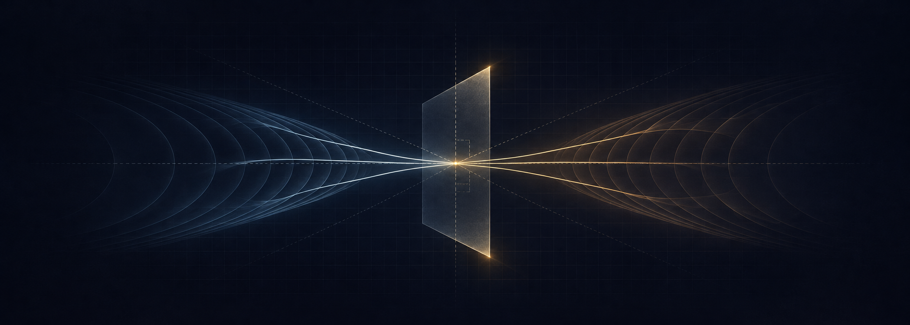

# A Dot Product Is All You Need

<p align="center">
  <strong>Quantum mechanics and special relativity from a single axiom</strong><br />
  <em>One dot product. Two readings of Pythagoras.</em>
</p>

<p align="center">
  <a href="verification/README.md#paper-1-plane"></a>
  <a href="https://emad-ii.github.io/dot-product/"></a>
  <a href="https://emad-ii.github.io/dot-product/talk/"></a>
  <a href="paper/A_Dot_Product_Is_All_You_Need_Final.pdf"></a>
  <a href="#run-it-yourself"></a>
</p>

<p align="center">
  
</p>

## Review scope

This is a mathematical determination theorem for a free massive scalar field, not an empirical claim that nature realizes its hypotheses. It uses the axiomatic method: its geometric axiom is a positive dot product, and the manuscript states the inference rules, symmetry assumptions and lattice data used in the proof.

Do the conclusions follow, and are they unique within the stated class? Question any hypothesis or proof step on its merits. Distinguish mathematical correctness and originality from empirical applicability. The default CI axiom report names one theorem. To assess Lean coverage, check the [current source](lean/A_Dot_Product_Is_All_You_Need_Final.lean) and [release manifest](release.json).

**Squared lengths add. Read that equation twice.** With the product rule it determines the Gaussian law of the readings. With the sum rule it determines the Born weights. The same geometry answers two questions that quantum theory usually treats separately: what the field readings look like, and how states give probabilities.

## The uniqueness and no-go theorem

**Axiom.** Displacements are measured by a single positive dot product $g$ in dimension $D \geq 2$.

For orthogonal displacements,

$$
\|x+y\|_g^2 = \|x\|_g^2 + \|y\|_g^2.
$$

In the positive-stiffness regime, maximizing entropy at the specified lattice moments fixes the finite-lattice covariance. As the mesh shrinks and the free boxes exhaust space, the joint laws of the smeared readings converge. Their continuum covariance operator is

$$
C = \hbar(-\Delta_g + m^2)^{-1}.
$$

**Uniqueness.** For each pair of positive scales $m$ and $\hbar$, the stated rules and lattice moments determine one law of the readings. Its reflected overlaps fix the state space up to a unitary preserving those readings.

**No-go.** Within the stated local polynomial class, every higher degree fails the reflection test. Two opposite pulses suffice to witness the failure.

**Special relativity.** Rotations continue to Lorentz boosts. The continued form $|x|_g^2-t^2$ gives the null cone $|x|_g=|t|$: the invariant speed is $c=1$ in the shared units used here. The result fixes the cone, not a numerical value for $c$ in independently chosen units.

## Follow the proof

1. **Rotate two copies.** The law of independent readings is unchanged by rotation of the copies. The characteristic function must turn addition of squared lengths into multiplication. That forces the Gaussian.
2. **Reflect two pulses.** The lattice entropy calculation gives a degree-one precision. Separately, two pulses with opposite signs provide a witness against each higher degree: its reflected square would be negative.
3. **Read the plane.** What the plane knows of a preparation supplies the inner product. The shift continues to unitary time evolution, and rotations continue to Lorentz boosts.
4. **Ask what an event weighs.** Orthogonal event weights add. Decomposing and recombining them fixes the squared-norm rule; the product rule gives composition and ideal projection conditioning.

The [paper](paper/A_Dot_Product_Is_All_You_Need_Final.pdf) gives the full argument in four pages. The [proof guide](docs/plane-proof-guide.md) maps the steps to Lean and the interactive figures.

## Lean-checked theorem

For positive $m$ and $\hbar$, `DotProduct.paper1_determination` identifies the unique law of the original Schwartz readings and reconstructs the field from that law. Conditioning square-integrable positive-side preparations on the plane gives the entire complex $L^2$ space of the plane law. On the corresponding Fock space the orthochronous Poincaré group acts unitarily and strongly continuously, and the spacetime field transforms covariantly on the finite-particle core.

`DotProduct.theorem1_table1_axioms` establishes the twelve Table 1 statements as formulated on that Fock space. For general laws satisfying the reflection, conditional independence, shift and continuity hypotheses of §4, `DotProduct.GeneralReflection.measured_evolution` gives unitary time evolution on the state space generated by the accessible preparations.

[Exact Lean source](lean/A_Dot_Product_Is_All_You_Need_Final.lean) · [Proof scope](docs/plane-proof-guide.md#what-the-plane-lean-file-proves) · [Verification record](verification/README.md)

## Run it yourself

The package pins Lean 4.34.1 and Mathlib `d13f23b`. With [Lean installed](https://leanprover-community.github.io/get_started.html), run from a fresh clone:

```sh
(cd lean && lake exe cache get)
bash scripts/check-lean.sh plane
python3 scripts/verify.py
```

To run the interactive explainer, install Node.js, then run `npm ci` and `npm run serve`. Open [localhost:4173](http://localhost:4173). The prebuilt page is included; `npm run build` regenerates it.

| Check | What it establishes |
| :--- | :--- |
| **Manuscript** | The hypotheses and argument for uniqueness of the law and reconstruction of the field |
| **Lean 4 / Mathlib** | The law-to-field determination, all twelve Table 1 statements and the general §4 reflection and evolution results |
| **SHA-256 manifest and site build** | The deposited files and the explainer's downloads agree |

The badge refers to the formal results above. The [verification record](verification/README.md) gives the reproducible check and axiom audit.

## Everything in one place

| Read or explore | Source |
| :--- | :--- |
| Four-page paper | [PDF](paper/A_Dot_Product_Is_All_You_Need_Final.pdf) · [LaTeX](paper/A_Dot_Product_Is_All_You_Need_Final.tex) |
| Formal companion | [Lean](lean/A_Dot_Product_Is_All_You_Need_Final.lean) · [Proof guide](docs/plane-proof-guide.md) |
| Interactive explainer and animated talk | [Watch the proof](https://emad-ii.github.io/dot-product/talk/) · [Interactive website](https://emad-ii.github.io/dot-product/) · [Build and run](docs/plane-proof-guide.md#build-the-website) · [Site source](site/) |
| Verify or cite | [Check record](verification/README.md) · [Manifest](release.json) · [Citation](CITATION.cff) |

[Download the complete repository](https://github.com/emad-ii/dot-product/archive/refs/heads/main.zip) to keep the paper, proof and explainer together.

## Challenge the mathematics

Which hypotheses force the Gaussian law? When do the two pulses exclude a higher-degree precision? Counterexamples satisfying the hypotheses and critiques of the hypotheses or their scope are welcome. Start with the [paper](paper/A_Dot_Product_Is_All_You_Need_Final.pdf) and the [proof scope](docs/plane-proof-guide.md#what-the-plane-lean-file-proves).

---

**Emad Mostaque · 26 November 2026**

**Acknowledgments.** This work used the Logos AI system, incorporating several frontier models. The Lean formalisation used GPT 6.2 Astra and Gemini Neon.
